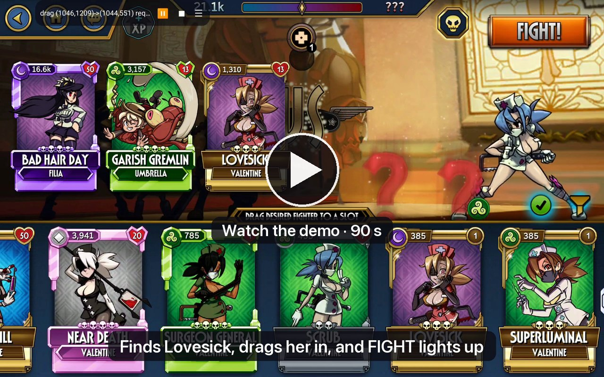

# SGM Bot

A bot that plays **Skullgirls Mobile** on its own: event maps, origin stories and prize fights. It runs entirely
on the Android device behind a small floating panel, reads the screen with OpenCV and Tesseract (no AI, no
network) and never spends anything.

[](docs/demo.mp4)

## What it does

Pick a mode on the panel (☰), press ▶ and leave it.

- **Event**: origin stories and event maps.
  - Reads the map and plays the next node, chapter by chapter, boss last.
  - Builds the team itself when a node has requirements: reads them (including "NEED … VARIANT" tooltips),
    filters your roster and drags the right fighter in.
- **Prize**: prize fights you don't want to grind by hand.
  - Picks the opponent with the best bonus under a power cap.
  - Saves energy: the cheapest gold fillers plus one anchor sized to the enemy, so strong fighters stay fresh.
    Fighters without enough bolts are skipped.
- **Auto**: works out which of the two you're on and switches by itself.

It never taps gems, purchases, energy refills or ads.

**Tested on:** origin stories, older prize fights, and monthly events (Lovesick, Gremlin-style maps).

## Get it

Download the APK from [Releases](../../releases) and install it on the device.

- **Needs:** a rooted Android device (Magisk), Android 11+, arm64. It's built and tested on a 2560x1600 tablet;
  other screens need their templates and positions checked first.
- **Other devices:** `docs/SETUP.md` covers requirements, other screens and the plan for no root. The repo is
  set up for coding agents too: point yours at it (`CLAUDE.md` is the entry point) and it has what it needs to
  adapt the bot to your device.

## For developers

- **Using it:** the Android app (`android/`) runs everything on the device behind the floating panel.
- **Developing it:** the same Python package (`bot/`) runs from the Mac over adb, with tests against 64
  reference screenshots.

Docs: `FLOW.md` (behaviour, the rules) · `docs/DEVELOPMENT.md` (how it works, how to change it) ·
`docs/SETUP.md` (setup on other devices) · `CLAUDE.md` (agent notes).

*Unofficial fan project, not affiliated with Hidden Variable or Autumn Games. Automating the game may break its
terms of service: use it at your own risk.*

## Use the app (no laptop needed)

1. Open **SGM Bot** on the tablet. Tap **Show overlay, then open the game** (the first time it asks for
   "Display over other apps").
2. In Skullgirls, tap **▶** on the translucent panel at the top left. Magisk asks for root once: allow it
   and choose "Forever".
3. The panel shows the current step: **⏸** pauses, **▶** resumes, **■** stops. **☰** opens recent steps and the
   mode (**Auto** detects event vs prize; Event / Prize force one) and pauses the bot while open. Mode changes
   apply from the next ▶. Drag the panel by its text.
   During an event fight it shows the tries left on that node: `[fight +++]`, and each loss turns a `+` into `✗`.
4. When the bot stops on its own, the reason is the last line on the panel (e.g. an unknown screen, or no
   opponent under the cap).

Log on the tablet: `/data/data/dev.umer.sgmbot/files/logs/bot.log`.

## Build / update the app (Mac)

```sh
cd android
./gradlew assembleDebug
adb install -r app/build/outputs/apk/debug/app-debug.apk   # stops a running bot
```

Needs JDK 17+, the Android SDK (path in `android/local.properties`) and Python 3.10
(`brew install python@3.10`). The build copies `bot/` and `templates/` into the app automatically.

## Releases

Download the latest APK from the repo's **Releases** page and open it on the tablet (or `adb install -r`).
The version is in `VERSION` (`MAJOR.MINOR.PATCH`, or `-beta.N` for pre-releases). To publish one, from a clean
`main` with `gh auth login` done:

```sh
./release.sh 0.1.0-beta.2   # tests, build, tag v0.1.0-beta.2, push, GitHub pre-release with the APK
./release.sh 0.1.0          # a final release
```

## Run from the Mac (development)

```sh
.venv/bin/python run.py look                 # what the bot sees on the current screen
.venv/bin/python run.py auto --minutes 5     # real run, stops after 5 minutes (Ctrl+C any time)
.venv/bin/python run.py event --dry-run      # decide and log, never tap
.venv/bin/python run.py prize                # force prize fights
./snap.sh <label>                            # save the tablet's screen to shots/ (reference / new screens)
./charge.sh off                              # stop the tablet charging over USB (it re-enables itself)
```

Logs: `logs/bot.log`; an annotated screenshot of every tap and error is saved in `logs/debug/`.
First-time setup: `python3 -m venv .venv && .venv/bin/pip install opencv-python-headless numpy pytesseract`
and `brew install tesseract`.

## Tests (offline, against `shots/`)

```sh
.venv/bin/python -m tests.test_screens   # every shot → expected screen
.venv/bin/python -m tests.test_readers   # scores, icons, cards, maps, areas… vs verified values
```

## Settings

Defaults and comments are in `bot/config.py`. Override any of them in `config.json` next to `run.py` (Mac):

```json
{ "max_enemy_total": 25000, "delay": [1.5, 3.0] }
```
